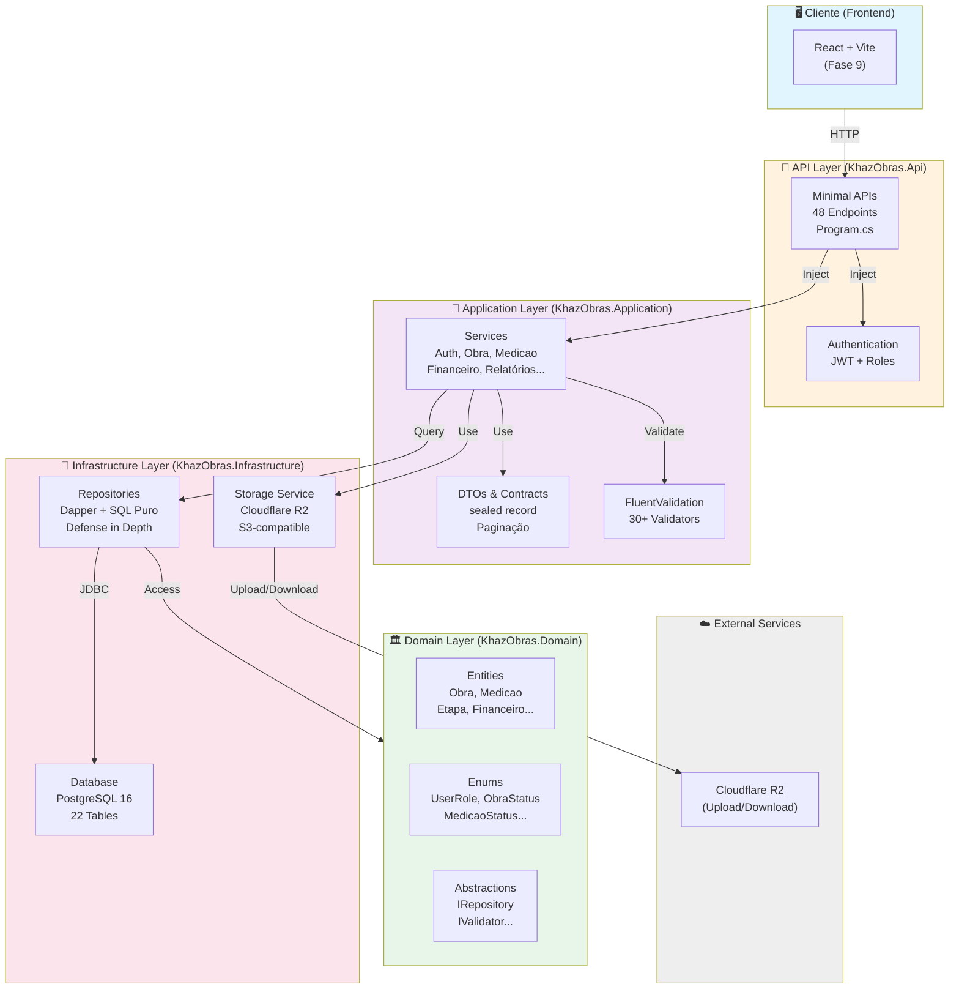
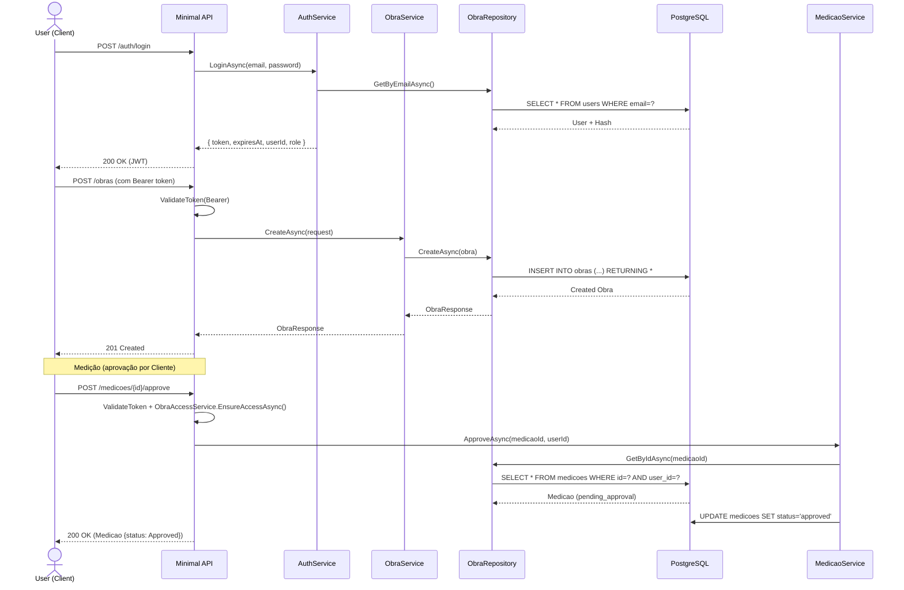
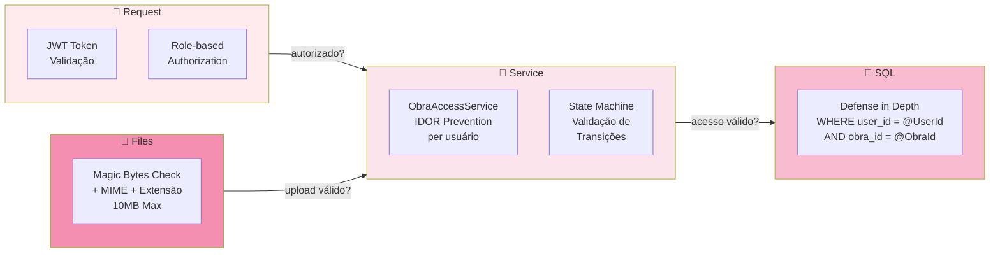

# KhazObras — Diagrama de Arquitetura



## Fluxo de Dados: Login → Criar Obra → Medição



## Segurança em Camadas



## Stack Tecnológico

| Camada | Tecnologia | Propósito |
|---|---|---|
| **Apresentação** | ASP.NET Core Minimal APIs | Endpoints REST com configuração declarativa |
| **Autenticação** | JWT + Roles | Stateless auth, claims-based authorization |
| **Validação** | FluentValidation | Regras de negócio em DTO |
| **Persistência** | Dapper + SQL Puro | Controle fino, queries otimizadas |
| **Banco de Dados** | PostgreSQL 16 | ACID, Enums nativos, jsonb |
| **Storage** | Cloudflare R2 | S3-compatible, upload/download de arquivos |
| **Testes** | xUnit + Fakes | Security tests (5), plano para integração |
| **Logging** | Serilog (config) | Message templates, estruturado |
| **Tratamento de Erro** | Global Exception Handler | ProblemDetails RFC 9110 |

## Clean Architecture — Responsabilidades

```
KhazObras.Api (Program.cs, 925 linhas)
├─ Configura DI
├─ Define 48 endpoints (Minimal APIs)
├─ Aplica autenticação & autorização
└─ Mapeia OpenAPI (agora sempre ativo, não só Development)

KhazObras.Application (77 arquivos)
├─ Services: Orquestração de lógica
├─ DTOs: Contratos (sealed record)
├─ Validators: Regras de validação (FluentValidation)
└─ Abstractions: Interfaces (IRepository, etc.)

KhazObras.Domain (23 arquivos)
├─ Entities: Modelos de domínio
├─ Enums: Estados (ObraStatus, MedicaoStatus, UserRole)
└─ Abstractions: Contratos de acesso

KhazObras.Infrastructure (21 arquivos)
├─ Repositories: Dapper + SQL (Repository Pattern)
├─ Storage: R2StorageService
├─ Persistence: IDbConnectionFactory, NpgsqlConnectionFactory
└─ Security: PasswordHasher, JwtTokenGenerator
```

## Fases do Projeto

```mermaid
gantt
    title Roadmap KhazObras (Fases 1-10)
    
    section Backend
    Fase 1 - Fundação : done, f1, 2026-09-01, 30d
    Fase 2 - Autenticação : done, f2, 2026-10-01, 20d
    Fase 3 - CRUD : done, f3, 2026-10-15, 25d
    Fase 4 - Medições : done, f4, 2026-10-20, 20d
    Fase 5 - Financeiro : done, f5, 2026-11-01, 25d
    Fase 6 - Relatórios : done, f6, 2026-11-15, 25d
    Fase 7 - Interno : done, f7, 2026-12-01, 20d
    Fase 8 - Finalização : done, f8, 2026-12-15, 15d
    
    section Documentation
    Audit : active, audit, 2026-10-12, 1d
    API.md : active, api, 2026-10-12, 1d
    Diagrams : crit, diagrams, 2026-10-12, 1d
    Postman : diag, postman, 2026-10-13, 1d
    
    section Frontend
    Fase 9 - React UI : f9, 2026-12-20, 60d
    Fase 10 - PDF & Email : f10, 2027-02-15, 30d
```

---

**Atualizado em:** 2026-10-12  
**Versão:** 1.0
