# KhazObras — Diagrama ER (Entity Relationship)

## Visão Geral

Backend KhazObras possui **22 tabelas** organizadas em 6 scripts versionados (001–006):
- **Núcleo:** users, obras, etapas, medicoes
- **Financeiro:** financeiro_lancamentos, financeiro_anexos
- **Relatórios:** relatorios_fotograficos, relatorios_fotograficos_fotos, relatorios_mensais
- **Interno:** fornecedores, prestadores, estoque, estoque_movimentacoes, pipeline
- **Documentos:** projetos_documentos
- **Sistema:** notificacoes, log_auditoria, user_obras (many-to-many)

---

## Diagrama ER Completo

```mermaid
erDiagram
    USERS ||--o{ OBRAS : "cria"
    USERS ||--o{ USER_OBRAS : "vinculado"
    OBRAS ||--o{ USER_OBRAS : "tem"
    OBRAS ||--o{ ETAPAS : "contém"
    OBRAS ||--o{ MEDICOES : "mede"
    ETAPAS ||--o{ MEDICOES : "tem"
    MEDICOES ||--o{ NOTIFICACOES : "dispara"
    OBRAS ||--o{ RELATORIOS_FOTOGRAFICOS : "tem"
    RELATORIOS_FOTOGRAFICOS ||--o{ RELATORIOS_FOTOGRAFICOS_FOTOS : "contém"
    OBRAS ||--o{ RELATORIOS_MENSAIS : "tem"
    OBRAS ||--o{ FINANCEIRO_LANCAMENTOS : "tem"
    FINANCEIRO_LANCAMENTOS ||--o{ FINANCEIRO_ANEXOS : "tem"
    OBRAS ||--o{ PROJETOS_DOCUMENTOS : "tem"
    OBRAS ||--o{ ESTOQUE : "tem"
    ESTOQUE ||--o{ ESTOQUE_MOVIMENTACOES : "tem"
    USERS ||--o{ NOTIFICACOES : "recebe"
    USERS ||--o{ LOG_AUDITORIA : "realiza"
    FORNECEDORES ||--o{ FINANCEIRO_LANCAMENTOS : "fornece"
    PRESTADORES ||--o{ MEDICOES : "participa"

    USERS {
        uuid id PK "Primary Key"
        string email UK "Unique Email"
        string name "Nome Completo"
        string password_hash "Hash bcrypt"
        string role "Master | Admin | Client"
        boolean is_active "Ativo/Inativo"
        timestamp created_at "Criação"
        timestamp updated_at "Atualização"
    }

    OBRAS {
        uuid id PK "Primary Key"
        uuid user_id FK "Criador (User)"
        string name "Nome da Obra"
        string endereco "Endereço"
        date data_inicio "Início"
        date previsao_conclusao "Conclusão Prevista"
        decimal valor_total "Orçamento Total"
        string status "Em Progresso | Concluída | Suspensa"
        text descricao "Descrição"
        timestamp created_at "Criação"
        timestamp updated_at "Atualização"
    }

    USER_OBRAS {
        uuid id PK "Primary Key"
        uuid user_id FK "Usuário"
        uuid obra_id FK "Obra"
        string role "Client | Admin | Supervisor"
        timestamp created_at "Vinculação"
    }

    ETAPAS {
        uuid id PK "Primary Key"
        uuid obra_id FK "Obra"
        string name "Nome Etapa"
        date data_inicio "Início"
        date data_termino "Término"
        decimal orcado "Orçado"
        decimal realizado "Realizado"
        integer percentual_concluido "0-100%"
        timestamp created_at "Criação"
        timestamp updated_at "Atualização"
    }

    MEDICOES {
        uuid id PK "Primary Key"
        uuid obra_id FK "Obra"
        uuid etapa_id FK "Etapa"
        uuid prestador_id FK "Prestador (optional)"
        string mes_referencia "YYYY-MM"
        decimal valor "Valor Medido"
        string status "PendingApproval | Approved | InvoiceIssued"
        text descricao "Descrição"
        timestamp approved_at "Aprovação"
        string numero_nota "NF-XXXX-XXX"
        date data_emissao "Emissão NF"
        timestamp invoiced_at "Faturamento"
        timestamp created_at "Criação"
        timestamp updated_at "Atualização"
    }

    RELATORIOS_FOTOGRAFICOS {
        uuid id PK "Primary Key"
        uuid obra_id FK "Obra"
        date data "Data do Relatório"
        text descricao "Descrição"
        integer foto_count "Contagem de Fotos"
        timestamp created_at "Criação"
        timestamp updated_at "Atualização"
    }

    RELATORIOS_FOTOGRAFICOS_FOTOS {
        uuid id PK "Primary Key"
        uuid relatorio_id FK "Relatório Fotográfico"
        string file_name "Nome Arquivo"
        integer file_size "Tamanho (bytes)"
        string s3_key "Chave R2/S3"
        timestamp uploaded_at "Upload"
    }

    RELATORIOS_MENSAIS {
        uuid id PK "Primary Key"
        uuid obra_id FK "Obra"
        string mes_referencia "YYYY-MM"
        string status "Draft | Published"
        text resumo "Resumo Mensal"
        timestamp published_at "Publicação"
        timestamp created_at "Criação"
        timestamp updated_at "Atualização"
    }

    FINANCEIRO_LANCAMENTOS {
        uuid id PK "Primary Key"
        uuid obra_id FK "Obra"
        uuid fornecedor_id FK "Fornecedor (optional)"
        string tipo "Receita | Despesa"
        text descricao "Descrição"
        decimal valor "Valor"
        date data "Data Lançamento"
        string categoria "Materiais | Mao de Obra | Terceiros..."
        timestamp created_at "Criação"
        timestamp updated_at "Atualização"
    }

    FINANCEIRO_ANEXOS {
        uuid id PK "Primary Key"
        uuid lancamento_id FK "Lançamento"
        string file_name "Nome Arquivo"
        integer file_size "Tamanho (bytes)"
        string s3_key "Chave R2/S3"
        timestamp uploaded_at "Upload"
    }

    PROJETOS_DOCUMENTOS {
        uuid id PK "Primary Key"
        uuid obra_id FK "Obra"
        string file_name "Nome Arquivo"
        integer file_size "Tamanho (bytes)"
        string tipo "Planta | Projeto | Contrato | Orçamento"
        string s3_key "Chave R2/S3"
        timestamp uploaded_at "Upload"
    }

    ESTOQUE {
        uuid id PK "Primary Key"
        uuid obra_id FK "Obra"
        string descricao "Descrição Item"
        integer quantidade "Quantidade"
        string unidade "Sacos | m3 | kg | unidade"
        decimal valor_unitario "Valor Unitário"
        timestamp created_at "Criação"
        timestamp updated_at "Atualização"
    }

    ESTOQUE_MOVIMENTACOES {
        uuid id PK "Primary Key"
        uuid estoque_item_id FK "Item Estoque"
        string tipo "Entrada | Saída"
        integer quantidade "Quantidade"
        integer saldo_anterior "Saldo Antes"
        integer saldo_atual "Saldo Depois"
        text observacao "Observação"
        timestamp registrada_at "Registro"
    }

    FORNECEDORES {
        uuid id PK "Primary Key"
        string name "Nome Fornecedor"
        string email "Email"
        string telefone "Telefone"
        string endereco "Endereço"
        timestamp created_at "Criação"
        timestamp updated_at "Atualização"
    }

    PRESTADORES {
        uuid id PK "Primary Key"
        string name "Nome Prestador"
        string especialidade "Estrutura | Hidráulica | Elétrica..."
        string email "Email"
        string telefone "Telefone"
        timestamp created_at "Criação"
        timestamp updated_at "Atualização"
    }

    PIPELINE {
        uuid id PK "Primary Key"
        string nome "Nome Etapa"
        text descricao "Descrição"
        integer ordem "Ordem"
        timestamp created_at "Criação"
        timestamp updated_at "Atualização"
    }

    NOTIFICACOES {
        uuid id PK "Primary Key"
        uuid user_id FK "Usuário"
        uuid obra_id FK "Obra (optional)"
        text modulos "Array JSON: [medicoes, financeiro...]"
        string canal "Email | WhatsApp"
        text assunto "Assunto"
        boolean lida "Lida/Não Lida"
        timestamp enviado_at "Envio"
        timestamp lida_at "Leitura"
        timestamp created_at "Criação"
    }

    LOG_AUDITORIA {
        uuid id PK "Primary Key"
        uuid usuario_id FK "Usuário Ação"
        string usuario_nome "Nome Usuário"
        string entidade "Obra | Medicao | Financeiro..."
        uuid entity_id "ID Entidade"
        string acao "Create | Update | Delete | Approve"
        jsonb detalhes_antes "Estado Anterior"
        jsonb detalhes_depois "Estado Novo"
        string endereco_ip "IP Origem"
        timestamp timestamp "Quando"
    }
```



---

## Tabelas Detalhadas

### 1. USERS — Usuários do Sistema
```sql
CREATE TABLE users (
    id UUID PRIMARY KEY DEFAULT gen_random_uuid(),
    email VARCHAR(255) NOT NULL UNIQUE,
    name VARCHAR(255) NOT NULL,
    password_hash VARCHAR(255) NOT NULL,
    role user_role NOT NULL DEFAULT 'Client',  -- Master | Admin | Client
    is_active BOOLEAN NOT NULL DEFAULT true,
    created_at TIMESTAMP NOT NULL DEFAULT CURRENT_TIMESTAMP,
    updated_at TIMESTAMP NOT NULL DEFAULT CURRENT_TIMESTAMP
);
```
**Índices:** `idx_email`, `idx_role`  
**Constraint:** Email único

---

### 2. OBRAS — Obras de Construção
```sql
CREATE TABLE obras (
    id UUID PRIMARY KEY DEFAULT gen_random_uuid(),
    user_id UUID NOT NULL REFERENCES users(id),
    name VARCHAR(255) NOT NULL,
    endereco TEXT NOT NULL,
    data_inicio DATE NOT NULL,
    previsao_conclusao DATE NOT NULL,
    valor_total DECIMAL(12,2) NOT NULL,
    status obra_status NOT NULL DEFAULT 'Em Progresso',
    descricao TEXT,
    created_at TIMESTAMP NOT NULL DEFAULT CURRENT_TIMESTAMP,
    updated_at TIMESTAMP NOT NULL DEFAULT CURRENT_TIMESTAMP
);
```
**Índices:** `idx_user_id`, `idx_status`  
**FK:** `user_id` → users(id)

---

### 3. USER_OBRAS — Vinculação Usuário-Obra (Many-to-Many)
```sql
CREATE TABLE user_obras (
    id UUID PRIMARY KEY DEFAULT gen_random_uuid(),
    user_id UUID NOT NULL REFERENCES users(id),
    obra_id UUID NOT NULL REFERENCES obras(id),
    role VARCHAR(50) NOT NULL,  -- Client | Admin | Supervisor
    created_at TIMESTAMP NOT NULL DEFAULT CURRENT_TIMESTAMP,
    UNIQUE(user_id, obra_id)
);
```
**Propósito:** Controlar acesso de usuários a obras específicas  
**Índices:** `idx_user_id`, `idx_obra_id`

---

### 4. ETAPAS — Fases de Obra
```sql
CREATE TABLE etapas (
    id UUID PRIMARY KEY DEFAULT gen_random_uuid(),
    obra_id UUID NOT NULL REFERENCES obras(id),
    name VARCHAR(255) NOT NULL,
    data_inicio DATE NOT NULL,
    data_termino DATE NOT NULL,
    orcado DECIMAL(12,2) NOT NULL,
    realizado DECIMAL(12,2) NOT NULL DEFAULT 0,
    percentual_concluido INTEGER NOT NULL DEFAULT 0,
    created_at TIMESTAMP NOT NULL DEFAULT CURRENT_TIMESTAMP,
    updated_at TIMESTAMP NOT NULL DEFAULT CURRENT_TIMESTAMP
);
```
**Índices:** `idx_obra_id`  
**FK:** `obra_id` → obras(id)

---

### 5. MEDICOES — Medições de Progresso
```sql
CREATE TABLE medicoes (
    id UUID PRIMARY KEY DEFAULT gen_random_uuid(),
    obra_id UUID NOT NULL REFERENCES obras(id),
    etapa_id UUID NOT NULL REFERENCES etapas(id),
    prestador_id UUID REFERENCES prestadores(id),
    mes_referencia VARCHAR(7) NOT NULL,  -- YYYY-MM
    valor DECIMAL(12,2) NOT NULL,
    status medicao_status NOT NULL DEFAULT 'PendingApproval',
    descricao TEXT,
    approved_at TIMESTAMP,
    numero_nota VARCHAR(50),
    data_emissao DATE,
    invoiced_at TIMESTAMP,
    created_at TIMESTAMP NOT NULL DEFAULT CURRENT_TIMESTAMP,
    updated_at TIMESTAMP NOT NULL DEFAULT CURRENT_TIMESTAMP
);
```
**Estados:** `PendingApproval` → `Approved` → `InvoiceIssued`  
**Índices:** `idx_obra_id`, `idx_status`, `idx_mes_referencia`

---

### 6. RELATORIOS_FOTOGRAFICOS — Relatórios Fotográficos
```sql
CREATE TABLE relatorios_fotograficos (
    id UUID PRIMARY KEY DEFAULT gen_random_uuid(),
    obra_id UUID NOT NULL REFERENCES obras(id),
    data DATE NOT NULL,
    descricao TEXT,
    created_at TIMESTAMP NOT NULL DEFAULT CURRENT_TIMESTAMP,
    updated_at TIMESTAMP NOT NULL DEFAULT CURRENT_TIMESTAMP
);
```
**Índices:** `idx_obra_id`, `idx_data`

---

### 7. RELATORIOS_FOTOGRAFICOS_FOTOS — Fotos em Relatório
```sql
CREATE TABLE relatorios_fotograficos_fotos (
    id UUID PRIMARY KEY DEFAULT gen_random_uuid(),
    relatorio_id UUID NOT NULL REFERENCES relatorios_fotograficos(id),
    file_name VARCHAR(255) NOT NULL,
    file_size INTEGER NOT NULL,
    s3_key VARCHAR(500) NOT NULL,  -- Chave no R2/S3
    uploaded_at TIMESTAMP NOT NULL DEFAULT CURRENT_TIMESTAMP
);
```
**Índices:** `idx_relatorio_id`

---

### 8. RELATORIOS_MENSAIS — Relatórios Consolidados
```sql
CREATE TABLE relatorios_mensais (
    id UUID PRIMARY KEY DEFAULT gen_random_uuid(),
    obra_id UUID NOT NULL REFERENCES obras(id),
    mes_referencia VARCHAR(7) NOT NULL,
    status relatorio_mensal_status NOT NULL DEFAULT 'Draft',
    resumo TEXT,
    published_at TIMESTAMP,
    created_at TIMESTAMP NOT NULL DEFAULT CURRENT_TIMESTAMP,
    updated_at TIMESTAMP NOT NULL DEFAULT CURRENT_TIMESTAMP
);
```
**Estados:** `Draft` → `Published`  
**Índices:** `idx_obra_id`, `idx_mes_referencia`, `idx_status`

---

### 9. FINANCEIRO_LANCAMENTOS — Lançamentos Financeiros
```sql
CREATE TABLE financeiro_lancamentos (
    id UUID PRIMARY KEY DEFAULT gen_random_uuid(),
    obra_id UUID NOT NULL REFERENCES obras(id),
    fornecedor_id UUID REFERENCES fornecedores(id),
    tipo VARCHAR(20) NOT NULL,  -- Receita | Despesa
    descricao TEXT NOT NULL,
    valor DECIMAL(12,2) NOT NULL,
    data DATE NOT NULL,
    categoria VARCHAR(100) NOT NULL,
    created_at TIMESTAMP NOT NULL DEFAULT CURRENT_TIMESTAMP,
    updated_at TIMESTAMP NOT NULL DEFAULT CURRENT_TIMESTAMP
);
```
**Tipos:** `Receita`, `Despesa`  
**Categorias:** `Materiais`, `Mao de Obra`, `Terceiros`, `Equipamento`  
**Índices:** `idx_obra_id`, `idx_tipo`, `idx_data`

---

### 10. FINANCEIRO_ANEXOS — Anexos de Lançamentos
```sql
CREATE TABLE financeiro_anexos (
    id UUID PRIMARY KEY DEFAULT gen_random_uuid(),
    lancamento_id UUID NOT NULL REFERENCES financeiro_lancamentos(id),
    file_name VARCHAR(255) NOT NULL,
    file_size INTEGER NOT NULL,
    s3_key VARCHAR(500) NOT NULL,
    uploaded_at TIMESTAMP NOT NULL DEFAULT CURRENT_TIMESTAMP
);
```
**Tipos Aceitos:** PDF, XLSX, DOCX

---

### 11. PROJETOS_DOCUMENTOS — Documentos/Projetos de Obra
```sql
CREATE TABLE projetos_documentos (
    id UUID PRIMARY KEY DEFAULT gen_random_uuid(),
    obra_id UUID NOT NULL REFERENCES obras(id),
    file_name VARCHAR(255) NOT NULL,
    file_size INTEGER NOT NULL,
    tipo VARCHAR(100) NOT NULL,  -- Planta | Projeto | Contrato
    s3_key VARCHAR(500) NOT NULL,
    uploaded_at TIMESTAMP NOT NULL DEFAULT CURRENT_TIMESTAMP
);
```

---

### 12. ESTOQUE — Itens de Estoque
```sql
CREATE TABLE estoque (
    id UUID PRIMARY KEY DEFAULT gen_random_uuid(),
    obra_id UUID NOT NULL REFERENCES obras(id),
    descricao VARCHAR(255) NOT NULL,
    quantidade INTEGER NOT NULL,
    unidade VARCHAR(50) NOT NULL,  -- Sacos | m3 | kg
    valor_unitario DECIMAL(10,2) NOT NULL,
    created_at TIMESTAMP NOT NULL DEFAULT CURRENT_TIMESTAMP,
    updated_at TIMESTAMP NOT NULL DEFAULT CURRENT_TIMESTAMP
);
```
**Índices:** `idx_obra_id`

---

### 13. ESTOQUE_MOVIMENTACOES — Movimentações de Estoque
```sql
CREATE TABLE estoque_movimentacoes (
    id UUID PRIMARY KEY DEFAULT gen_random_uuid(),
    estoque_item_id UUID NOT NULL REFERENCES estoque(id),
    tipo VARCHAR(20) NOT NULL,  -- Entrada | Saída
    quantidade INTEGER NOT NULL,
    saldo_anterior INTEGER NOT NULL,
    saldo_atual INTEGER NOT NULL,
    observacao TEXT,
    registrada_at TIMESTAMP NOT NULL DEFAULT CURRENT_TIMESTAMP
);
```
**Tipos:** `Entrada`, `Saída`

---

### 14. FORNECEDORES — Fornecedores
```sql
CREATE TABLE fornecedores (
    id UUID PRIMARY KEY DEFAULT gen_random_uuid(),
    name VARCHAR(255) NOT NULL,
    email VARCHAR(255),
    telefone VARCHAR(20),
    endereco TEXT,
    created_at TIMESTAMP NOT NULL DEFAULT CURRENT_TIMESTAMP,
    updated_at TIMESTAMP NOT NULL DEFAULT CURRENT_TIMESTAMP
);
```
**Índices:** `idx_email`

---

### 15. PRESTADORES — Prestadores de Serviço
```sql
CREATE TABLE prestadores (
    id UUID PRIMARY KEY DEFAULT gen_random_uuid(),
    name VARCHAR(255) NOT NULL,
    especialidade VARCHAR(100),  -- Estrutura | Hidráulica | Elétrica
    email VARCHAR(255),
    telefone VARCHAR(20),
    created_at TIMESTAMP NOT NULL DEFAULT CURRENT_TIMESTAMP,
    updated_at TIMESTAMP NOT NULL DEFAULT CURRENT_TIMESTAMP
);
```

---

### 16. PIPELINE — Pipeline de Processos
```sql
CREATE TABLE pipeline (
    id UUID PRIMARY KEY DEFAULT gen_random_uuid(),
    nome VARCHAR(255) NOT NULL,
    descricao TEXT,
    ordem INTEGER NOT NULL,
    created_at TIMESTAMP NOT NULL DEFAULT CURRENT_TIMESTAMP,
    updated_at TIMESTAMP NOT NULL DEFAULT CURRENT_TIMESTAMP
);
```
**Uso:** Gestão interna de etapas de processos

---

### 17. NOTIFICACOES — Notificações de Usuários
```sql
CREATE TABLE notificacoes (
    id UUID PRIMARY KEY DEFAULT gen_random_uuid(),
    user_id UUID NOT NULL REFERENCES users(id),
    obra_id UUID REFERENCES obras(id),
    modulos JSONB NOT NULL,  -- ["medicoes", "financeiro"]
    canal VARCHAR(50) NOT NULL,  -- Email | WhatsApp
    assunto TEXT,
    lida BOOLEAN NOT NULL DEFAULT false,
    enviado_at TIMESTAMP NOT NULL DEFAULT CURRENT_TIMESTAMP,
    lida_at TIMESTAMP,
    created_at TIMESTAMP NOT NULL DEFAULT CURRENT_TIMESTAMP
);
```
**Índices:** `idx_user_id`, `idx_lida`  
**Propósito:** Base para integração email/WhatsApp

---

### 18. LOG_AUDITORIA — Log de Auditoria
```sql
CREATE TABLE log_auditoria (
    id UUID PRIMARY KEY DEFAULT gen_random_uuid(),
    usuario_id UUID NOT NULL REFERENCES users(id),
    usuario_nome VARCHAR(255),
    entidade VARCHAR(100) NOT NULL,  -- Obra | Medicao
    entity_id UUID NOT NULL,
    acao VARCHAR(50) NOT NULL,  -- Create | Update | Delete | Approve
    detalhes_antes JSONB,
    detalhes_depois JSONB,
    endereco_ip VARCHAR(50),
    timestamp TIMESTAMP NOT NULL DEFAULT CURRENT_TIMESTAMP
);
```
**Índices:** `idx_usuario_id`, `idx_entidade`, `idx_timestamp`  
**Propósito:** Rastreabilidade completa de ações

---

## Enums do PostgreSQL

```sql
CREATE TYPE user_role AS ENUM ('Master', 'Admin', 'Client');
CREATE TYPE obra_status AS ENUM ('Em Progresso', 'Concluída', 'Suspensa');
CREATE TYPE medicao_status AS ENUM ('PendingApproval', 'Approved', 'InvoiceIssued');
CREATE TYPE relatorio_mensal_status AS ENUM ('Draft', 'Published');
```

---

## Migração (Versionada)

Scripts SQL são aplicados sequencialmente:
1. **001_init.sql** — Schema inicial (users, obras, user_obras)
2. **002_etapas_medicoes.sql** — Etapas e medições
3. **003_relatorios.sql** — Relatórios fotográficos e mensais
4. **004_financeiro.sql** — Lançamentos e anexos
5. **005_interno.sql** — Fornecedores, prestadores, estoque, pipeline
6. **006_auditoria.sql** — Log de auditoria e notificações

**Nunca editar scripts já aplicados.** Nova mudança = novo script `007_*.sql`.

---

## Índices e Performance

| Tabela | Índice | Razão |
|---|---|---|
| users | email (UNIQUE) | Login rápido |
| obras | user_id, status | Filtro por usuário e status |
| etapas | obra_id | Listar etapas por obra |
| medicoes | obra_id, status, mes_referencia | Fluxo de aprovação |
| financeiro_lancamentos | obra_id, tipo, data | Relatórios financeiros |
| notificacoes | user_id, lida | Listar não lidas |
| log_auditoria | usuario_id, timestamp | Auditoria por período |
| user_obras | (user_id, obra_id) | UNIQUE, acesso por usuário |

---

## Relacionamentos Principais

### Cliente → Obras
- 1 Cliente cria N Obras
- Cliente acessa via USER_OBRAS (many-to-many com filtro de role)

### Obra → Etapas → Medições
- 1 Obra tem N Etapas
- 1 Etapa tem N Medições
- Medição: máquina de estados (pending → approved → invoiced)

### Obra → Financeiro
- 1 Obra tem N Lançamentos
- 1 Lançamento pode ter N Anexos (R2)

### Obra → Relatórios
- 1 Obra tem N Relatórios Fotográficos (N Fotos cada)
- 1 Obra tem N Relatórios Mensais (draft → published)

### Obra → Documentos & Estoque
- 1 Obra tem N Projetos/Documentos
- 1 Obra tem N Itens de Estoque (movimentações rastreadas)

---

**Atualizado em:** 2026-10-12  
**Total de Tabelas:** 22  
**Scripts de Migração:** 6 (001–006)  
**Documentação:** Completa
